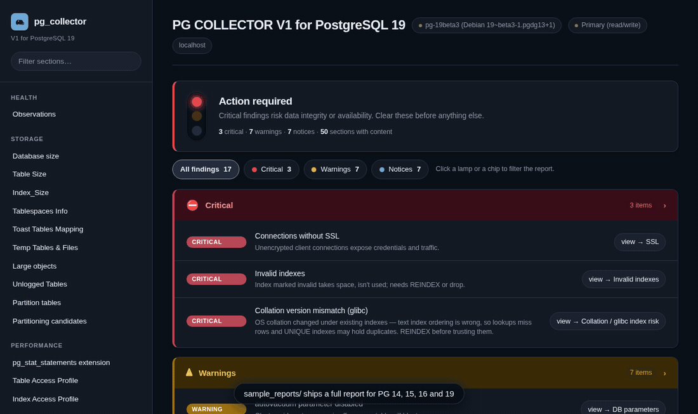
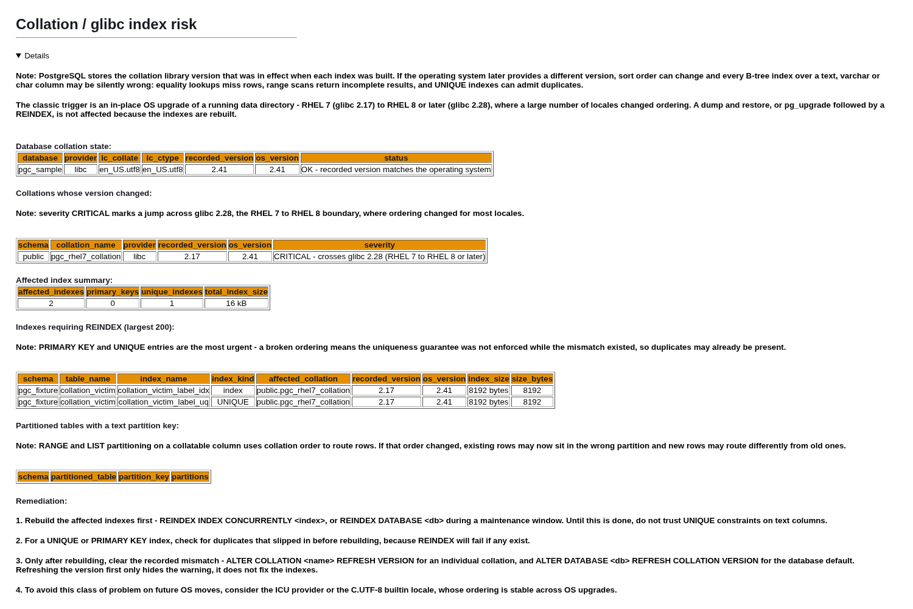
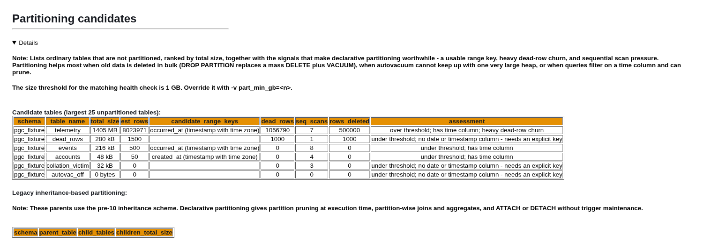
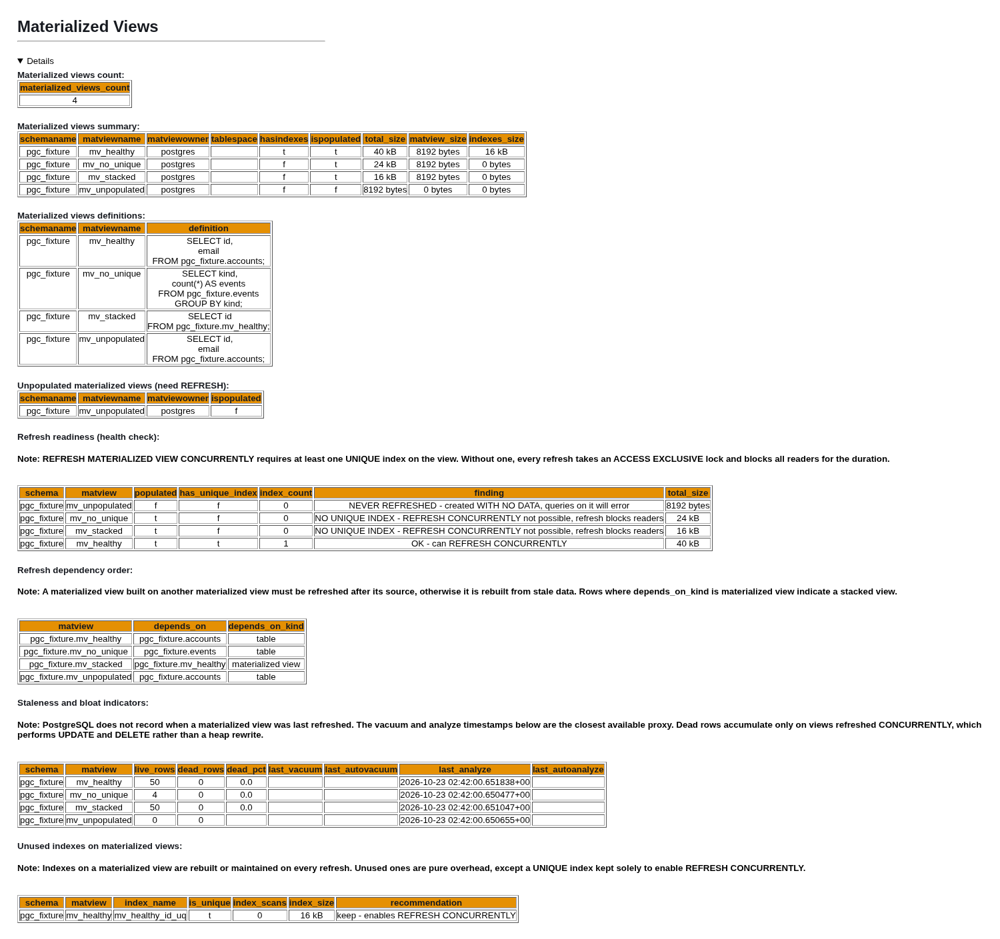

# PG Collector  

## Table of Contents
- [Overview](#overview)
- [PG Collector's Automated Database Health check](#pg-collectors-automated-database-health-check)
- [PG Collector report header](#pg-collector-report-header)
- [Example of PG Collector report](#example-of-pg-collector-report)
- [Modern viewer: traffic-light report](#modern-viewer-traffic-light-report)
- [PG Collector output](#pg-collector-output)
- [How to run PG Collector script](#how-to-run-pg-collector-script--pg_collectorsql-)
- [Running against a production database (read-only)](#running-against-a-production-database-read-only)
- [Selective Section Execution](#selective-section-execution)
- [PG Collector & AI](#pg-collector--ai)
- [Notes](#notes)
- [License](#license)

## Overview

PG Collector for [Postgresql](https://www.postgresql.org/) is a sql script that gathers valuable database information and presents it in a consolidated HTML file which provides a convenient way to view and navigate between different sections of the report.

PG Collector is safe to run on production environments and does not create any database objects to produce the output.

With PG Collector an operator gains insights on various aspects of the database, such as:
* Database size
* Configuration parameters
* Installed extensions
* Vacuum & Statistics
* Unused Indexes & invalid indexes
* Users & Roles Info
* Toast Tables Mapping
* Database schemas 
* Fragmentation (Bloat)
* Tablespaces Info
* Memory setting
* Tables and Indexes Size and info
* Transaction ID
* Replication slots
* public Schema info 
* Unlogged Tables

and more, please check the example reports 

## PG Collector's Automated Database Health check

The Observations section has been implemented as an automated database health assessment system designed to identify potential database issues and provide actionable recommendations .

The observations section seamlessly integrates with existing PG Collector report sections, providing cross-references to detailed analysis and supporting data.

more health checks will be added with each new version .

Database Health check list :
```
   1- Duplicate indexes
   2- Invalid indexes
   3- Unused Indexes
   4- Autovacuum parameter
   5- Sequences with less than 10% of the remain values
   6- Orphaned prepared transactions
   7- Connections without SSL
   8- Enable_indexonlyscan parameter
   9- Excessive logging parameters
   10- Track_counts parameter
   11- Enable_indexscan parameter
   12- Synchronous_commit parameter
   13- Invalid databases
   14- Tables with more than 20% dead rows
   15- Transaction ID TXID (Wraparound)
   16- Tables that have autovacuum_enabled=off on table level
   17- Inactive replication slots
   18- Logical replication spill files
   19- Outdated Extensions
   20- Parameters pending restart
   21- Collation version mismatch (glibc 2.28 / RHEL 7 to RHEL 8 index corruption)
   22- Materialized views unpopulated or unable to REFRESH CONCURRENTLY
   23- Large tables that are not partitioned
```
### Example of The Observations section


## Sample report

Four full reports are checked in, one per PostgreSQL major, all generated
against a database seeded with `tests/fixtures/` so they deliberately trigger
most of the health checks listed above.



| Report | Generated with | Rendered |
|---|---|---|
| [`pg_collector_pg19_sample-2026-10-22.html`](sample_reports/pg_collector_pg19_sample-2026-10-22.html) | this branch's script | [view](https://htmlpreview.github.io/?https://github.com/tarunvignesh/pg-collector/blob/ui-modern-pg19/sample_reports/pg_collector_pg19_sample-2026-10-22.html) |
| [`pg_collector_pg16_sample-2026-10-27.html`](sample_reports/pg_collector_pg16_sample-2026-10-27.html) | `pg-collector-for-postgresql-16` | [view](https://htmlpreview.github.io/?https://github.com/tarunvignesh/pg-collector/blob/ui-modern-pg19/sample_reports/pg_collector_pg16_sample-2026-10-27.html) |
| [`pg_collector_pg15_sample-2026-10-27.html`](sample_reports/pg_collector_pg15_sample-2026-10-27.html) | `pg-collector-for-postgresql-15` | [view](https://htmlpreview.github.io/?https://github.com/tarunvignesh/pg-collector/blob/ui-modern-pg19/sample_reports/pg_collector_pg15_sample-2026-10-27.html) |
| [`pg_collector_pg14_sample-2026-10-27.html`](sample_reports/pg_collector_pg14_sample-2026-10-27.html) | `pg-collector-for-postgresql-14` | [view](https://htmlpreview.github.io/?https://github.com/tarunvignesh/pg-collector/blob/ui-modern-pg19/sample_reports/pg_collector_pg14_sample-2026-10-27.html) |

GitHub serves `.html` files from a repository as source text rather than
rendering them, so the **Rendered** column goes through an HTML preview proxy.
Downloading a file and opening it in a browser works too, as does dropping it
onto [the viewer](#modern-viewer-traffic-light-report).

**Each report was generated by its own major's script, not by this one.**
PG Collector ships one branch per PostgreSQL major, and that is not a
formality: this branch's script queries catalog columns that do not exist
further back, so running it against PG16 silently drops around fourteen
queries (`parallel_workers_to_launch`, `wal_buffers_full`,
`max_dead_tuple_bytes`, `datlocale`) and against PG14 closer to twenty, taking
the collation and ICU checks with them. Run the branch that matches your
server. The viewer does not care which one produced the report - it groups
every section of all four into the same sidebar.

### Collation / glibc index risk

Detects indexes left mis-ordered by an operating-system collation change - most
commonly an in-place RHEL 7 (glibc 2.17) to RHEL 8+ (glibc 2.28) upgrade, where
sort order changed for most locales. Affected text indexes silently return
incomplete results, and affected UNIQUE indexes may already hold duplicates.



### Partitioning candidates

Ranks unpartitioned tables by size alongside the signals that make declarative
partitioning pay off: a usable range key, dead-row churn, bulk deletes and
sequential-scan pressure. The size threshold defaults to 50 GB and is
configurable with `-v part_min_gb=<n>`.



### Materialized view health

Reports which materialized views can be refreshed concurrently, the order they
must be refreshed in when stacked on one another, staleness and bloat
indicators, and indexes that only cost refresh time.



## Modern viewer: traffic-light report

[`tools/enhance.html`](tools/enhance.html) is a single static HTML file that
renders any `pg_collector_*.html` report as a modern, filterable page. It reads
the report in your browser - nothing is uploaded, and the original file is not
modified. No Node, no Python, no npm, no CDN, no build step.


What it adds on top of the raw report:

- **Traffic light verdict.** The lamp for the worst severity present is lit -
  red for critical, amber for warning, blue for notice, green when nothing
  fired - with a headline that says what to do about it (*Action required*,
  *Needs attention*, *Minor notices only*, *All clear*) rather than a row of
  numbers you have to rank yourself.
- **Severity filtering.** Click a lamp or a chip and the whole report narrows
  to that severity: the findings, the sidebar, and the detail sections. Click
  it again, or *All findings*, to clear.
- **Full-text search** across every section, which composes with the active
  severity filter.
- **Severity rubric.** Every classification is an opinion of the viewer, not of
  the script; the sidebar links to the full rubric with the reasoning for each
  check, and the rubric is a plain array you can edit.
- **Grouped sidebar** with scroll-spy, **sortable tables** with numeric columns
  right-aligned, size-column bar charts, a `pgtune`-style view of
  `DB parameters`, and light / dark / auto themes.

Open it and drag a report onto the page:

```bash
xdg-open tools/enhance.html      # or just double-click the file
```

The `?report=URL` query parameter auto-loads a report instead, which needs any
static HTTP server because browsers block cross-origin `file://` fetches:

```bash
python3 -m http.server 8770
# then visit:
# http://127.0.0.1:8770/tools/enhance.html?report=/sample_reports/pg_collector_pg19_sample-2026-10-22.html
```

Severity classification, section grouping, wording and initial state are all
config arrays at the top of the file - see [tools/README.md](tools/README.md)
for worked examples, and [tools/CUSTOMIZING.md](tools/CUSTOMIZING.md) for
making a newly added report section render well in it.

## PG Collector report header 


## Example of PG Collector report 

[pg_collector v2.9](http://pg-collector.s3-website-us-west-2.amazonaws.com/pg_collector_postgres-2021-08-02_181348.html)

[pg_collector v2.7](http://pg-collector.s3-website-us-west-2.amazonaws.com/pg_collector_postgres-2020-12-14_053537.html)

All Sample reports in [sample report folder](https://github.com/awslabs/pg-collector/tree/main/sample_reports).


## PG Collector output

### Report name:
PG Collector script will generate HTML file using the following naming convention pg_collector_[DB Name]-[timestamp].html .

[DB Name] : is the database name that you are connected to.

```
Example : pg_collector_testdb-2020-10-10_030920.html
```


### Report location: 
PG Collector generates the HTML report under [/tmp](https://tldp.org/LDP/Linux-Filesystem-Hierarchy/html/tmp.html) by default.

To save the report to a different location, pass `-v outdir=/your/path`:

```bash
psql -h [hostname] -p [port] -d [dbname] -U [user] -v outdir=/home/user/reports -f pg_collector.sql
```

> **Note:** The output directory must already exist before running the script. PG Collector will not create it automatically.
> If the directory does not exist, psql cannot open the output file and the HTML report will be printed to the terminal screen instead of saved to a file.


## How to run PG Collector script ( pg_collector.sql )

1- you need [psql](https://www.postgresql.org/docs/current/app-psql.html) to be able to connect to the postgresql DB and run the pg_collector.sql script 

It is recommended that you use a psql version that matches the same server major version or higher .

2- Download pg_collector.sql in your laptop or the host that want to access the database from 

3- login to the database using psql 
```
psql -h [hostname or RDS endpoint] -p [Port] -d [Database name ] -U [user name] 
```
4- run the pg_collector.sql script 

```
\i pg_collector.sql 
\q
```
or use -f option in psql 

```
psql -h [hostname or RDS endpoint] -p [Port] -d [Database name ] -U [user name] -f pg_collector.sql 
```

Example :

```
mohamed@mydevhost ~ % psql -h testdb-instance-1.cimdlffuw.us-west-2.rds.amazonaws.com -p 5432 -d testdb -U mohamed
psql (9.4.8, server 10.6)
WARNING: psql major version 9.4, server major version 10.6.
         Some psql features might not work.
SSL connection (protocol: TLSv1.2, cipher: ECDHE-RSA-AES256-GCM-SHA384, bits: 256, compression: off)
Type "help" for help.

testdb=> \i pg_collector.sql
SET
statement_timeout set to 5 minutes. To change, edit the SET statement_timeout line in the script.
Output format is html.
Output format is aligned.
Query buffer reset (cleared).
Report Generated Successfully
Report name and location:  /tmp/pg_collector_testdb-2019-10-07_215146.html
testdb=> \q
mohamed@mydevhost ~ %ls -lhrt /tmp/pg_collector_*
-rw-r--r-- 1 mohamed mohamed 569K Oct  7 21:51 /tmp/pg_collector_testdb-2019-10-07_215146.html

```
5-  open the report using any internet browser


## Running against a production database (read-only)

PG Collector only reads. The script issues no `INSERT`, `UPDATE`, `DELETE`,
`CREATE`, `ALTER`, `DROP`, `GRANT`, `VACUUM` or `ANALYZE`; it creates no tables,
no functions and no extensions, and it calls no side-effecting server function.
The single change it makes to anything is `SET statement_timeout = '5min'` on
its own session, which lasts only as long as that connection.

That is checked, not asserted. `tests/lint/check_safety.py` tokenizes the
script and fails the build if any one of its 597 statements is write-class, and
the runtime harness additionally runs the whole thing as an unprivileged role
and diffs every non-catalog relation before and after.

Being read-only by construction and being *prevented* from writing are still
different guarantees, though, and on a production database you may want the
second one. Both options below were verified against PostgreSQL 19 to produce a
report identical to a superuser run - same 50 sections, same 220 tables, zero
errors.

### Option 1: enforce read-only on the connection

**There is no `--read-only` switch in psql** - the flag does not exist. What
does exist is a libpq connection parameter, `options`, which hands a server
setting to the backend at connect time. Put it in the connection string and the
whole thing stays on one command line:

```bash
psql "host=[host] port=[port] dbname=[dbname] user=[user] \
      options='-c default_transaction_read_only=on'" \
     -f pg_collector.sql
```

The same setting via the environment, if you prefer flags to a connection
string:

```bash
PGOPTIONS="-c default_transaction_read_only=on" \
    psql -h [host] -p [port] -d [dbname] -U [user] -f pg_collector.sql
```

Or set it as the first thing the session does, which works because psql runs
`-c` and `-f` in the order given, on one connection:

```bash
psql -h [host] -p [port] -d [dbname] -U [user] \
     -c "SET SESSION CHARACTERISTICS AS TRANSACTION READ ONLY" \
     -f pg_collector.sql
```

All three were verified on PostgreSQL 19 to reject every write class:

```
ERROR:  cannot execute INSERT in a read-only transaction
ERROR:  cannot execute UPDATE in a read-only transaction
ERROR:  cannot execute DELETE in a read-only transaction
ERROR:  cannot execute TRUNCATE TABLE in a read-only transaction
ERROR:  cannot execute CREATE TABLE in a read-only transaction
```

**Know what this does and does not buy you.**
`default_transaction_read_only` has `USERSET` context, which means any session
can turn it back off:

```sql
SET default_transaction_read_only = off;   -- succeeds, for any role
INSERT INTO ...                            -- now writes
```

So it is a guardrail against accidents, not a security boundary. It is a sound
guardrail *for this script specifically*, because the script cannot quietly
escape it: `tests/lint/check_safety.py` allowlists only `statement_timeout`,
`lock_timeout` and `idle_in_transaction_session_timeout`, so a
`SET default_transaction_read_only = off` anywhere in `pg_collector.sql` fails
the build. If you want a guarantee that does not depend on the script being
honest, use Option 2 - privileges cannot be switched off with `SET`.

### Option 2: a dedicated read-only role

Better for anything recurring, because the guarantee lives with the role rather
than with whoever remembers the environment variable:

```sql
CREATE ROLE pgc_readonly LOGIN PASSWORD '...';
GRANT CONNECT ON DATABASE [dbname] TO pgc_readonly;
GRANT USAGE ON SCHEMA public TO pgc_readonly;

-- Predefined read-only roles. These exist from PostgreSQL 10.
GRANT pg_read_all_stats, pg_read_all_settings, pg_monitor TO pgc_readonly;

-- PostgreSQL 14 and later only. On 13 and earlier, grant SELECT per schema:
--   GRANT SELECT ON ALL TABLES IN SCHEMA [schema] TO pgc_readonly;
--   GRANT SELECT ON ALL SEQUENCES IN SCHEMA [schema] TO pgc_readonly;
GRANT pg_read_all_data TO pgc_readonly;

-- Two objects default to superuser-only and are read-only; without these the
-- pg_config and pg_hba.conf sections come back empty rather than erroring.
GRANT EXECUTE ON FUNCTION pg_config() TO pgc_readonly;
GRANT EXECUTE ON FUNCTION pg_hba_file_rules() TO pgc_readonly;
GRANT SELECT ON pg_hba_file_rules TO pgc_readonly;   -- PG13 needs the view too

-- Belt and braces: every transaction this role opens is read-only.
ALTER ROLE pgc_readonly SET default_transaction_read_only = on;
```

Then run as that role:

```bash
psql -h [host] -p [port] -d [dbname] -U pgc_readonly -f pg_collector.sql
```

To confirm the session really is read-only:

```
=> show default_transaction_read_only;
 on
=> create table should_fail(i int);
ERROR:  cannot execute CREATE TABLE in a read-only transaction
```

### Note on sequences before PostgreSQL 14

`pg_sequences.last_value` returns `NULL`, not an error, for a sequence the
caller cannot `SELECT`. On PG13 and earlier - where there is no
`pg_read_all_data` to cover it - a role missing sequence privileges makes the
"sequence approaching its maximum" check report *OK* rather than failing
loudly. Grant `SELECT ON ALL SEQUENCES` if you want that check to be
trustworthy.

### Running against a standby

A hot standby is read-only by definition and is a good place to run this. The
report notes the server's role (Primary or Standby) in its header. Some
sections read cluster-wide write activity that is quieter on a replica, so
prefer the primary when you are diagnosing write-path problems.

## Selective Section Execution 

PG Collector supports running a specific sections of the report instead of the full report. This is useful for:

- Quick focused troubleshooting (e.g., check vacuum stats only or Observations (Health checks))
- Large databases where a full report takes too long
- Targeted Aurora or Limitless diagnostics

### List Available Sections

```bash
psql -v help=t -f pg_collector.sql
```

Output:
```
PG Collector - Available Sections:

  Variable Name     Description
  -------------     -----------
  observations    - Observations (Health checks)
  db_size         - Database size
  txid            - Transaction ID TXID (Wraparound)
  table_size      - Table Size
  index_size      - Index Size
  vacuum          - Vacuum & Statistics
  extensions      - Extensions
  memory          - Memory setting
  pgss            - pg_stat_statements extension
  users           - Users & Roles Info
  schema          - Schema Info
  tablespaces     - Tablespaces Info
  table_access    - Table Access Profile
  unused_idx      - Unused Indexes
  index_access    - Index Access Profile
  bloat           - Fragmentation (Bloat)
  toast           - Toast Tables Mapping
  replication     - Replication
  sessions        - Sessions/Connections Info
  prepared_txn    - Orphaned prepared transactions
  pk_fk           - PK or FK using numeric/integer
  public_schema   - public Schema
  invalid_idx     - Invalid indexes
  privileges      - Access privileges
  default_privileges - Default access privileges
  pgaudit         - pgaudit extension
  unlogged_tables - Unlogged Tables
  ssl             - SSL
  bg_processes    - Background processes
  mxid            - Multixact ID MXID
  temp            - Temp Tables & Files
  large_objects   - Large objects
  partitions      - Partition tables
  sequences       - Sequences
  pg_hba          - pg_hba.conf
  dup_idx         - Duplicate indexes
  functions       - Functions statistics
  db_load         - DB Load
  triggers        - Triggers
  pg_config       - pg_config
  db_params       - DB parameters
  copy_progress   - COPY command progress
  idx_progress    - Index Creation Progress
  invalid_db      - Invalid databases
  mat_views       - Materialized Views
  foreign_servers - Foreign Servers
  pg_shdepend     - pg_shdepend (shared object dependencies)
  fk_no_index     - FK without index
  collation_risk  - Collation / glibc index risk
  part_candidates - Partitioning candidates

  ---------- Aurora PostgreSQL ----------
  aurora_version          - Aurora version
  aurora_builtins         - Aurora built-in functions
  aurora_instance_id      - Aurora db instance identifier
  aurora_cluster          - Aurora cluster instances
  aurora_replica_lag      - Aurora reader instances - Replica Lag
  aurora_ccm              - Aurora cluster cache management (CCM)
  aurora_global_db        - Aurora global db status
  aurora_wait_events      - Aurora wait event stat
  aurora_qpm              - Query Plan Management (QPM)
  aurora_dml              - Aurora DML activity
  aurora_memctx           - Process memory context usage
  aurora_stat_stmt        - Aurora_stat_statements
  aurora_stat_plans       - Aurora_stat_plans
  aurora_wal_cache        - Logical replication write-through cache

  ---------- Aurora Limitless ----------
  limitless_routers       - Routers & Shards Info
  limitless_params        - Limitless parameters
  limitless_databases     - Limitless databases
  limitless_extensions    - Limitless Extensions
  limitless_txid          - Limitless Transaction ID TXID
  limitless_tables        - Limitless Tables
  limitless_stat_stmt     - limitless_stat_statements
  limitless_msq           - Multi shard queries (MSQ)
  limitless_sso           - Single Shard Optimized (SSO)
  limitless_sessions      - Limitless Sessions/Connections
  limitless_dist_sess     - Distributed sessions info
  limitless_wait_events   - Limitless Database Load (Wait events)
```

### Run Specific Sections

Pass `-v fullmod=f` to enable selective mode, then `-v <section>=t` for each section you want:

```bash
# Vacuum & Statistics only
psql -h [hostname] -p [port] -d [dbname] -U [user] -v fullmod=f -v vacuum=t -f pg_collector.sql

# Vacuum and Replication together
psql -h [hostname] -p [port] -d [dbname] -U [user] -v fullmod=f -v vacuum=t -v replication=t -f pg_collector.sql

# Observations (Health checks)
psql -h [hostname] -p [port] -d [dbname] -U [user] -v fullmod=f -v observations=t -f pg_collector.sql

# Size analysis
psql -h [hostname] -p [port] -d [dbname] -U [user] -v fullmod=f -v db_size=t -v table_size=t -v index_size=t -f pg_collector.sql

# Aurora QPM section
psql -h [hostname] -p [port] -d [dbname] -U [user] -v fullmod=f -v aurora_qpm=t -f pg_collector.sql
```

### Full Report (Default)

No extra variables needed — works exactly as before:

```bash
psql -h [hostname] -p [port] -d [dbname] -U [user] -f pg_collector.sql
```

### Terminal Output in Selective Mode

```
SET
statement_timeout set to 5 minutes. To change, edit the SET statement_timeout line in the script.
Output format is html.
Generating specific sections in the Report:
  - Vacuum & Statistics
  - Replication
Output format is aligned.
Query buffer reset (cleared).
Report Generated Successfully
Report name and location: /tmp/pg_collector_mydb-2026-06-15_111308.html
```

The HTML report header will show a "Partial Report" banner listing the included sections with clickable links. The DB INFO header (version, uptime, host) always runs regardless of mode.

> **Note:** Only the value `t` enables a section. Any other value (`f`, `0`, or not set) skips the section.


## PG Collector & AI

PG Collector HTML reports are designed for humans — beautiful tables, clickable navigation, everything formatted nicely. But when feeding reports into an AI model, all that HTML markup translates to a lot of unnecessary tokens.

### Convert HTML → Markdown

Use [Pandoc](https://pandoc.org/installing.html) to strip the HTML markup and retain only the structured data. This reduces token consumption by ~70% vs raw HTML, making AI analysis significantly faster and cheaper.

```bash
pandoc pg_collector_report.html -f html -t markdown -o pg_collector_report.md
```

Example:

```bash
pandoc pg_collector_postgres-2026-02-13_053714.html -f html -t markdown -o pg_collector_postgres-2026-02-13_053714.md
```

### Combine with Selective Section Execution

For even greater efficiency, generate a focused report covering only the sections relevant to your question before converting:

```bash
# Generate a focused vacuum + bloat report
psql -v fullmod=f -v vacuum=t -v bloat=t -f pg_collector.sql

# Convert to Markdown for AI analysis
pandoc /tmp/pg_collector_mydb-2026-02-13_053714.html -f html -t markdown -o report.md
```

This gives the AI model only the data it needs — no noise, fewer tokens, sharper answers.

## Notes:
1- it is ok to see below errors while executing the pg_collector.sql script if you did not install pg_stat_statements extension

```
postgres=> \i pg_collector.sql
Output format is html.
Default footer is off.
psql:pg_collector.sql:481: ERROR:  relation "pg_stat_statements" does not exist
LINE 10: from pg_stat_statements
              ^
psql:pg_collector.sql:495: ERROR:  relation "pg_stat_statements" does not exist
LINE 10: from pg_stat_statements
              ^
psql:pg_collector.sql:509: ERROR:  relation "pg_stat_statements" does not exist
LINE 10: from pg_stat_statements
              ^
psql:pg_collector.sql:523: ERROR:  relation "pg_stat_statements" does not exist
LINE 10: from pg_stat_statements
              ^
postgres=> \q
```

2- If the database has tens of thousands of tables, some queries can take longer time.
The script sets `statement_timeout = 5 minutes` by default to prevent any single query from hanging indefinitely.
If a query exceeds 5 minutes, it will be cancelled and the script will continue to the next section.
To change the default timeout, edit the `SET statement_timeout` line at the top of the pg_collector.sql script.

```
SET
statement_timeout set to 5 minutes. To change, edit the SET statement_timeout line in the script.
Output format is html.
Output format is aligned.
Query buffer reset (cleared).
Report Generated Successfully
Report name and location: /tmp/pg_collector_testdb-2026-06-11_223030.html
```


3- It is acceptable to observe the following errors while executing the pg_collector.sql script on Amazon Aurora PostgreSQL if the Cluster Cache Manager is disabled.

```
postgres=> \i pg_collector.sql
Output format is html.
psql:/tmp/pg_collector.sql:2766: ERROR: Cluster Cache Manager is disabled
psql:/tmp/pg_collector.sql:2769: ERROR: Cluster Cache Manager is disabled
Report Generated Successfully
Report name and location: /tmp/pg_collector_postgres-2024-09-09_161216.html

```

# Testing

The `tests/` directory contains a lint + runtime harness that asserts the
script is read-only, structurally valid, and triggers the expected
observation warnings.

Local run, against your own Postgres (creates and drops a temp database):

```bash
PGHOST=localhost PGUSER=postgres \
    ./tests/run.sh --isolate --seed populated --with-pgss --with-aurora-mock
```

CI runs the same harness in a GitHub Actions matrix (PG 17 / 18 / 19beta3 ×
pgss on/off × seed empty/populated × aurora none/mocked).

- [TESTING.md](TESTING.md) — what each test proves, in plain English.
- [tests/README.md](tests/README.md) — running locally, flag reference,
  the read-only-against-real-DB variant.
- [tests/DESIGN.md](tests/DESIGN.md) — fixture architecture and gotchas.

# License

This library is licensed under the MIT-0 License. See the LICENSE file.
